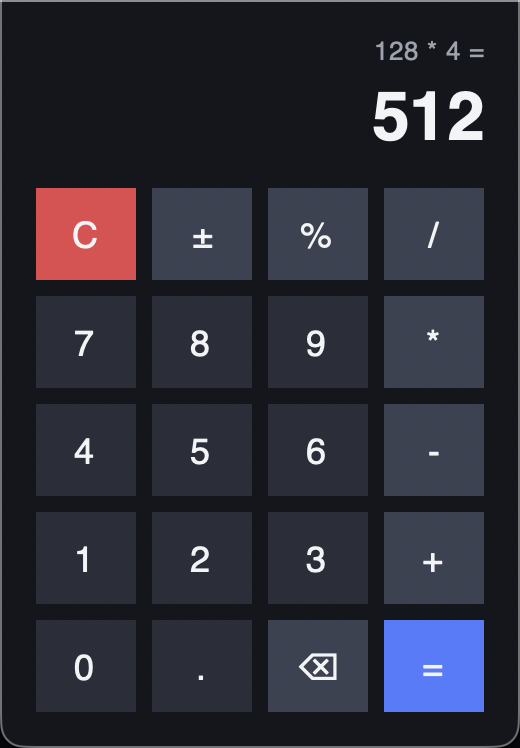

# GUI Calculator

A desktop calculator built with Python and Tkinter. It started as a command-line exercise from my Python course
(type two numbers and an operator) and I turned it into a proper app with a window, buttons and keyboard support.



## Features
- Add, subtract, multiply, divide, percent and ± sign change
- Chained operations (`2 + 3 + 4 =`) and a history line above the result
- Keyboard support: digits, `+ - * /`, `Enter` for equals, `Backspace`, `Esc` to clear
- Clear error for division by zero instead of a crash
- Dark theme with hover effects (custom buttons, because Tkinter's default buttons ignore colours on macOS)

## Run it
```bash
python calculator.py
```
Needs Python 3.10+ (uses `match`). Tkinter comes with Python on Windows and macOS; on Linux install `python3-tk`.

## Tests
```bash
python -m unittest
```

## What I learned
- How event-driven GUIs work: every button and key press calls a function
- Keeping the maths (`calculate`) separate from the interface so it can be tested on its own
